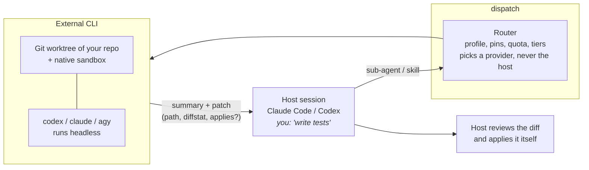

# Dispatch

**Work in one coding agent. Let the others you already pay for do the routine tasks.**

[](https://github.com/dragonfly25/dispatch/actions/workflows/ci.yml)
[](https://github.com/dragonfly25/dispatch/releases)
[](LICENSE)
[](https://nodejs.org)
[](#requirements)

Dispatch lets you work in one coding agent (Claude Code or Codex) and have delegable tasks run by
the *other* agents you already pay for. A task goes to the official CLI of another provider
(`claude`, `codex`, `agy`), runs headless in an isolated git worktree, and comes back to your session
as a summary and a patch. Which provider gets the task is decided by rules you can read and change:
remaining quota, task type, file paths, pins.

## Why

- **No dead stops.** With three subscriptions you normally use one at a time, and when it hits its
  limit work stops even though the other two have quota left. Dispatch spreads routine work (tests,
  docs, reviews, refactors) over the providers that have headroom.
- **Your session stays in charge.** The session you are in remains the orchestrator. The result comes
  back as a summary and a patch; you or the host review the diff and apply it.
- **Explainable.** Routing is a plain-YAML rule set, and every decision is logged and can be explained
  after the fact (`dispatch explain`).

**What it is not.** It is not a new agent framework, not an API proxy, and not a replacement for your
orchestrator. It does not use API keys in place of your subscriptions (unless you opt in to an API
pool), does not manage logins, and never applies a patch, makes a commit or opens a PR. If you do not
use agents, you will not notice it.

## How it works



## Quick start

### Requirements

- macOS or Linux (Windows is not supported).
- Node.js 22.13 or newer.
- At least two of these CLIs, installed and logged in: `claude` (Claude Code), `codex` (Codex CLI),
  `agy` (Antigravity CLI). One of them is your host; the others are delegation targets. Dispatch
  never logs in for you.
- A git repository to work in.

### 1. Install

The package is not published yet, so install from a clone:

```sh
git clone https://github.com/dragonfly25/dispatch.git && cd dispatch
```

```sh
pnpm install && pnpm build
```

Then put the binary on your `PATH`:

```sh
npm link
```

`npm link` fails with `EACCES` when your npm prefix is root-owned. Either link the binary yourself
(make sure `~/.local/bin` is on your `PATH`):

```sh
mkdir -p ~/.local/bin && ln -s "$PWD/dist/cli.mjs" ~/.local/bin/dispatch
```

or switch to a user-owned prefix (`npm config set prefix ~/.npm-global`, add `~/.npm-global/bin` to
`PATH`) and run `npm link` again. Check it with `dispatch --version`.

Once the package is published, `npm i -g @dragonfly25/dispatch` will replace these steps.

### 2. Set up your account (once per user)

```sh
dispatch setup
```

It asks four questions (your main client, the plan of each provider, a starting strategy, an
autonomy ceiling), shows the exact files it will write, and applies them only after you confirm.
It never edits your `CLAUDE.md`, `AGENTS.md`, skills, existing sub-agents or any project file.

<details>
<summary>What setup asks, what it writes, and the trust grants</summary>

The four questions are the only things setup cannot find out by itself:

1. the client you mainly use (Claude Code, Codex, or no preference);
2. the plan of each provider it found (for example `max5x` or `pro` for Claude, `plus` for Codex;
   "unknown" is fine and skips it), which feeds the quota estimates;
3. your starting strategy (`balance`, `preserve` or `specialize`);
4. the autonomy ceiling for delegated agents (`read-only`, `worktree`, `direct`; `worktree` is the default).

It writes a commented `~/.dispatch/config.yaml`, the launcher `~/.dispatch/bin/dispatch`, a manifest
that lets uninstall undo every edit, and the host integration (a user-scope Claude Code plugin; a
Codex skill, hooks and rules file). Antigravity stays off unless you opt in (see
[Billing and terms](#billing-and-terms)). The full file table, the non-interactive flags
(`--non-interactive --yes --plan claude=max5x --plan codex=plus --profile balance`) and the
`--answers <file>` format are in [docs/setup.md](docs/setup.md).

Setup asks you to accept two **trust grants**. Read them before saying yes:

- **Codex rules file.** Codex runs shell commands in a sandbox with no network, so `dispatch run`
  could not work from inside it. The rules file allows exactly one thing outside the sandbox: the
  absolute launcher path with the subcommands `run`, `wait`, `cancel` and `status`. Commands that
  chain, pipe, redirect or expand (`;`, `&&`, `|`, `$`, backticks) never match it.
- **Codex hook approval.** Codex only runs hooks you have approved. After setup, start Codex, open
  `/hooks`, and approve the Dispatch hooks. There is no CLI for this. Until you do, the Codex side
  stays inert (the skill still works when asked).

**Claude permission rule.** Dispatch never edits your Claude permissions. If the `dispatch` sub-agent
should run without a prompt for every call, add the two rules printed by `dispatch doctor` to
`permissions.allow` in `~/.claude/settings.json`:

```
Bash(~/.dispatch/bin/dispatch run:*)     # doctor prints the absolute path of your launcher
Bash(~/.dispatch/bin/dispatch wait:*)
```

</details>

### 3. Enable it in a repository

```sh
cd your-repo && dispatch install
```

This creates only `.dispatch/` in the repo (config, routing profiles, tier mappings, and a
`.gitignore` for local state). Nothing else is touched, including your root `.gitignore`. It runs
`dispatch setup` first if you have not. Repo policy is code (it decides where tasks go), so Dispatch
ignores it until you trust it: `install` records the hash of the files, and `dispatch trust`
re-records it after you review a change.

<details>
<summary>Install flags</summary>

`--profile <name>` (default `balance`), `--unspecified-model inherit|classify|<tier>`, `--no-trust`,
`--force`, `--skip-setup`, and `--non-interactive --yes` for scripts and CI. When it has to run setup
first, it accepts the setup answer flags too (`--plan`, `--host`, `--autonomy`, `--answers`,
`--enable-antigravity`, `--accept-agy-terms`). More in [docs/setup.md](docs/setup.md).

</details>

### 4. Check it

```sh
dispatch doctor
```

`doctor` spends no quota. It checks the platform, the launcher, the config, repo trust, each provider
CLI (binary, version, flags, login), the pool each one draws from, the quota channel, and the host
integration. Each warning comes with a `fix:` line. `dispatch status` then shows one line per provider
with remaining quota, reset time, and how much to trust the number (`real`, `estimated`, `stale`,
`unknown`).

<details>
<summary>More doctor modes</summary>

```sh
dispatch doctor --live        # one tiny real task per provider; asks first, uses a little quota
dispatch doctor --live --provider codex,claude -y
dispatch doctor --from-host   # run it from inside Claude Code or Codex: checks what a call from there needs
```

</details>

### 5. First delegation

Open a **new** Claude Code session in the repo (plugins load at session start) and ask for something
delegable:

> Write unit tests for the auth module.

The session sees the Dispatch policy, hands the task to the `dispatch` sub-agent, and the sub-agent
runs `dispatch run --detach` and `dispatch wait`. The router picks a provider other than Claude, the
task runs in a worktree, and you get back a summary (marked as coming from an external agent) and the
path of a patch. Claude reviews the diff and applies it with its own tools.

To see what would happen without running anything:

```sh
dispatch explain --task "write unit tests for the auth module" --task-type test --path src/auth
```

## Using it

### From Claude Code

Start a new session in the repo and ask for something delegable, or ask directly: "delegate this to
Codex". The `dispatch` sub-agent runs the task through `dispatch run --detach` and `dispatch wait`;
Claude reviews the returned patch and applies it with its own tools. If the sub-agent should not
prompt for every call, add the permission rules described under
[Claude permission rule](docs/setup.md#claude-permission-rule).

### From Codex

Codex works the same way through its skill, and the hook denies native sub-agent spawns with a message
that redirects the task to Dispatch. Codex only runs hooks you have approved: after `dispatch setup`,
start Codex, open `/hooks`, and approve the Dispatch hooks. There is no CLI for this, and until you do
the Codex side stays inert (the skill still works when asked).

### From a terminal or a script (no host)

```sh
dispatch run --task "Add unit tests for src/auth.ts" --task-type test --path src/auth.ts --json
```

With no host, every provider is a candidate. The result is one JSON object (schema version 1) with
`status`, `outcome`, `externalAgent`, `summary`, `patch` (`path`, `diffstat`, `applies`, `needsReview`),
`decisions` and `usage`. The exit code follows the outcome: 0 success, 2 usage or config error,
3 rejected, 4 failed, 5 quota exhausted, 6 timeout or state error, 75 still running.

For long tasks use `dispatch run --detach --json ...` (prints a `runId`; add `--idempotency-key <key>`
so a repeated call returns the same run), then `dispatch wait <runId> --json --timeout 120`, which
returns the result or exits 75 while the run is still going. `dispatch cancel <runId>` stops the
agent; nothing is applied. Custom frameworks (LangGraph, CrewAI, your own) call `dispatch` the same
way. A Python example and the details are in [docs/scripting.md](docs/scripting.md).

## Everyday commands

| Command | What it does |
| --- | --- |
| `dispatch run --task "..."` | Route a task and run it on the chosen provider. `--dry-run` only explains. `--json` for machines. `--provider <instance>` pins one. Also `--task-file`, `--task-type`, `--path`, `--model`, `--tier`, `--effort`, `--autonomy`, `--timeout`, `--detach`, `--idempotency-key`. |
| `dispatch wait <runId> [--timeout s]` / `dispatch cancel <runId>` | Collect (exit 75 while still running) or stop a run started with `run --detach`. |
| `dispatch explain --task "..."` | Show the routing decision with the rule that produced each step. `--replay <decisionId>` re-runs the router on a recorded decision and diffs it. |
| `dispatch status` | Quota per provider instance, with reset, source and reliability. |
| `dispatch status --set codex 40` | Correct the remaining percentage by hand (`--window`, `--ttl`, default 6h). |
| `dispatch status --compare [--since 7d]` | What each profile would have done on your recorded decisions. |
| `dispatch use <profile>` / `dispatch profiles` | Switch the active routing profile / list profiles. |
| `dispatch logs [--task <runId>] [--follow]` | List recent runs, show one run's decisions and events, or tail running ones. |
| `dispatch gc [--older-than 24h] [--dry-run]` | Remove worktrees of finished runs, old history and stale leases. |
| `dispatch validate` | Check the effective configuration; exit 2 on any error. |
| `dispatch providers` | Provider instances, the pool each draws from, adapter version. |
| `dispatch trust` | Trust the repo's current `.dispatch/` policy files. |
| `dispatch doctor [--live]` | Diagnose the installation and the providers. |
| `dispatch uninstall [--global]` | Remove Dispatch from this repo, or from this user account. See [Update, reconfigure, uninstall](#update-reconfigure-uninstall). |

Most read commands accept `--json`.

## Routing in one minute

The router is a pure function: same configuration, task and quota snapshot give the same decision.
It evaluates, in a fixed order, and the first match in a layer wins:

1. **Pins**: rules from `config.yaml` that win whatever the profile, for example "everything under
   `db/migrations/**` stays on the host" (`action: { type: host }`).
2. **Direct mappings**: explicit `model:effort -> provider:model:effort` entries that bypass tiers.
3. **Rules of the active profile**, top to bottom.
4. **Tier preset** and the default (stay on the host).

Shipped profiles (plain YAML in `.dispatch/profiles/`, no hidden logic; copy one to make your own):

| Profile | Optimises for |
| --- | --- |
| `balance` (default) | Reaching the end of the week with every provider usable: delegates to the one with the most quota left. |
| `preserve` | Keeping the host free for interactive work: delegates everything delegable. |
| `specialize` | Quality per task type: a task-type to preferred-provider table, with fallback by quota. |
| `off` | No delegation; everything stays on the host. Useful for comparison and debugging. |

- **Tiers and effort.** Requests are normalised to `tier` (`fast`, `balanced`, `max`) and `effort`
  (`low`, `medium`, `high`), and each provider resolves them through its own model table. When the host
  does not name a model, `unspecified_model` decides the tier (default `balanced`). The mapping presets
  are `mirror` (default), `economy` (effort one step lower on external providers) and `custom`.
- **Quota thresholds.** Per instance, `soft` (default 20% remaining: avoid if there is an alternative)
  and `hard` (default 5%: never use). A provider that reports `quota_exhausted` is unavailable until its
  reset, and the task falls back to the next provider, then back to the host with the reason. Missing
  quota data never blocks routing: it degrades to estimates.
- **Shadow mode.** List other profiles in `shadow_profiles` and every real decision also records what
  they would have chosen. `dispatch status --compare` summarises this over a time window, labelled as an
  estimate; nothing is simulated or executed.

The full key reference, precedence rules, trust and an annotated example are in
[docs/configuration.md](docs/configuration.md).

## Safety

Delegated agents run headless, so there are no interactive confirmations. Safety comes from isolation
and from you reviewing the result.

| What | How |
| --- | --- |
| Worktree and native sandbox | Each task gets its own git worktree under `~/.dispatch/worktrees/`. The real boundary is each CLI's own sandbox, with reads of credential paths and Dispatch's own files denied; if that sandbox is unavailable Dispatch fails closed instead of running unprotected. The child gets a minimal environment (an allow-list), cannot start another delegation (`max_depth`), and has a timeout. Network access is not restricted by Dispatch, because the CLIs need it. |
| Autonomy levels | `read-only` (analysis only, text back), `worktree` (default: edits in the worktree, patch back), `direct` (writes to your working copy; opt-in and discouraged). |
| Patch filter | The patch is rejected or trimmed if it touches `..` or absolute paths, symlinks, `.git*`, `.dispatch/`, host config directories, `.env*` or pinned paths. A best-effort secret scan flags suspicious content (`needsReview`), and `git apply --check` runs against your working tree. |
| No automatic apply | Dispatch never applies patches, commits, or opens PRs. The host or you review the diff and apply it. |
| Untrusted output | The external agent's summary is marked `EXTERNAL_AGENT_OUTPUT`; the host is told to treat it as data, never as instructions. |
| Settings only tighten | Autonomy, providers, concurrency, network and similar keys can be loosened only in your global config. A repo or a flag can make them stricter, never looser, and repo policy is ignored until you `dispatch trust` it. |
| Secrets | Dispatch does not copy, store, log or send credentials. It never calls a provider's private API with your tokens: quota comes from each CLI's own commands and events, and state is redacted before it is written. |
| Collaborators see nothing | Host integration lives at user scope. The repo only gains `.dispatch/`; `dispatch uninstall` removes it and leaves the tree as it was. A colleague who clones the repo without Dispatch gets no errors and no behaviour change; hooks exit silently when it is missing. |

More detail, including the threat model and the tests that prove each claim: [docs/security.md](docs/security.md).

## Billing and terms

Dispatch only runs official CLIs with the logins you already have. What that costs you, and what the
providers allow, is theirs to define and it changes. As of November 2026:

> [!WARNING]
> **Claude subscriptions.** Automated, high-volume fan-out through a Claude subscription is a grey
> area. Check your plan's terms before you rely on it.
>
> **Antigravity (`agy`).** Google's FAQ says wrapping `agy` in third-party applications is not
> supported under consumer plans and may lead to account suspension. The Antigravity target is
> therefore experimental, off by default, read-only and opt-in.

- **Claude (`claude -p`).** Anthropic's
  [support article](https://support.claude.com/en/articles/15036540-use-the-claude-agent-sdk-with-your-claude-plan)
  (dated 2026-10-07) says headless `claude -p` draws on your subscription, and the announced June change is paused.
  Max, Ultra and Team plans also have monthly API credits, a separate pool you can opt in to.
- **Codex.** A ChatGPT login draws on your plan limits. OpenAI recommends API keys for automation, and
  an API key is a separate billing pool.
- **Antigravity (`agy`).** With a consumer login the target stays disabled until you accept Google's terms in
  `dispatch setup` (`--enable-antigravity --accept-agy-terms`, which writes `tos_acknowledged: true`
  to your global config). Use an API-credit login if you want to avoid the issue.

`dispatch providers` and `dispatch status` show which pool each instance consumes (`subscription`,
`api_credit` or `unknown`). Dispatch does not work around any of these rules: it never calls private
endpoints with your tokens and never copies credentials. You are responsible for staying within the
terms of your own plans.

## Update, reconfigure, uninstall

| Command | What it does |
| --- | --- |
| `dispatch setup --reconfigure` | Change the answers in an existing `~/.dispatch/config.yaml` (client, plans, strategy, autonomy). |
| `dispatch setup --refresh` | Re-render the launcher and host files after Node or Dispatch moved (upgrade, reinstall), and remove edits that are no longer planned. |
| `dispatch uninstall` | In this repo: removes `.dispatch/` (asks first; `--force` also removes files edited since install). |
| `dispatch uninstall --global` | Reverts every edit recorded in the setup manifest (the launcher, the Claude plugin, the Codex hooks and rules) and removes `~/.dispatch`; `--keep-home` keeps config and state. Files you or other tools added are left alone. |

## Troubleshooting

Run `dispatch doctor`; each line has a status and a `fix:`. The usual ones:

<details>
<summary><code>launcher ... points at paths that no longer exist</code></summary>

Node or Dispatch moved (upgrade, reinstall): `dispatch setup --refresh`.

</details>

<details>
<summary><code>&lt;path&gt; does not exist (setup has not run)</code> or <code>config.global ... does not exist</code></summary>

Run `dispatch setup`.

</details>

<details>
<summary><code>.dispatch/ exists but is not trusted</code> or <code>changed since it was trusted</code></summary>

The repo policy is ignored. Review `.dispatch/`, then `dispatch trust`.

</details>

<details>
<summary><code>&lt;cli&gt; was not found on PATH</code></summary>

Install the CLI, or set `providers.<id>.binary` in `~/.dispatch/config.yaml`.

</details>

<details>
<summary><code>not logged in</code> or <code>login state is unknown</code></summary>

`codex login`; for `claude` and `agy` run the CLI once interactively. `doctor --live` proves the login.

</details>

<details>
<summary><code>claude-code.permission-rule</code> warns</summary>

Add the printed `Bash(... run:*)` and `Bash(... wait:*)` rules to `permissions.allow`.

</details>

<details>
<summary><code>CODEX_SANDBOX</code> set (<code>host.codex-rule</code>)</summary>

The Codex rule did not match. Use the absolute launcher path and a single-quoted task, run
`dispatch setup --refresh`, and approve the Dispatch hooks in Codex `/hooks`.

</details>

<details>
<summary><code>quota channel is broken</code></summary>

A provider changed its format. Routing continues on estimates and `status` shows `stale`; update
Dispatch, or set `quota.readers.<id>.enabled: false`.

</details>

Other useful commands: `dispatch validate` (config errors), `dispatch explain` (why a task went where it
went), `dispatch logs --task <runId>` (what happened in a run).

## Documentation

| Document | What is in it |
| --- | --- |
| [Configuration reference](docs/configuration.md) | Every key of the config, profile and mapping files, precedence, trust. |
| [Setup and install](docs/setup.md) | What `setup` asks and writes, trust grants, permission rule, `install` flags, `doctor` modes. |
| [Scripting](docs/scripting.md) | `dispatch run --json`, exit codes, detach and wait, Python example. |
| [Security](docs/security.md) | Threat model and the tests that prove each claim. |
| [Writing an adapter](docs/guides/writing-an-adapter.md) | Add a provider CLI. |
| [Writing a host integration](docs/guides/writing-a-host-integration.md) | Support another agent client. |
| [Manual acceptance tests](docs/manual-tests/README.md) | Step-by-step scripts for the parts that need a real account. |
| [Documentation index](docs/README.md) and [Plan](docs/PLAN.md) | All docs and the approved design. |
| [STATUS.md](STATUS.md) | Project state. |
| [CHANGELOG.md](CHANGELOG.md) | Release notes. |

## Contributing

Start at [docs/README.md](docs/README.md). Adding a provider CLI: [Writing an adapter](docs/guides/writing-an-adapter.md).
Supporting another agent client: [Writing a host integration](docs/guides/writing-a-host-integration.md).
The design is in [docs/PLAN.md](docs/PLAN.md) and the project state in [STATUS.md](STATUS.md).

```sh
pnpm install && pnpm build && pnpm lint && pnpm typecheck && pnpm test && pnpm check:boundaries
```

## License

[MIT](LICENSE).
