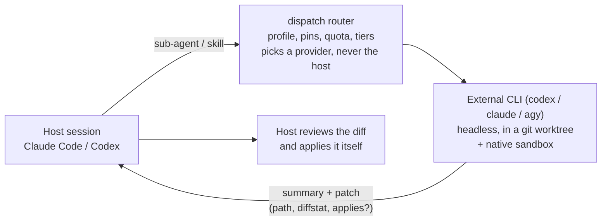

# Dispatch

**Work in one coding agent. Let the others you already pay for do the routine tasks.**

[](https://github.com/dragonfly25/dispatch/actions/workflows/ci.yml)
[](https://github.com/dragonfly25/dispatch/releases)
[](LICENSE)
[](https://nodejs.org)
[](#requirements)

Dispatch lets you work in one coding agent (Claude Code or Codex) and have delegable tasks run by
the *other* agents you already pay for. A task goes to the official CLI of another provider
(`claude`, `codex`, `agy`), runs headless in an isolated git worktree, and comes back to your session
as a summary and a patch. Which provider gets the task is decided by rules you can read and change:
remaining quota, task type, file paths, pins.

## Why

- **No dead stops.** With three subscriptions you normally use one at a time; when it hits its limit,
  work stops while the other two have quota left. Dispatch spreads routine work (tests, docs, reviews,
  refactors) over the providers with headroom.
- **Your session stays in charge.** It remains the orchestrator; results come back as a summary and a
  patch that you or the host review and apply.
- **Explainable.** Routing is plain YAML, and every decision is logged and can be explained afterwards
  (`dispatch explain`).

**What it is not.** Not a new agent framework, not an API proxy, not a replacement for your
orchestrator. It does not use API keys in place of your subscriptions (unless you opt in to an API
pool), does not manage logins, and never makes a commit or opens a PR; it applies a patch only for
an intercepted Claude Code custom agent (auto-apply, below).

## How it works



## Quick start

### Requirements

- macOS or Linux (Windows is not supported), Node.js 22.13 or newer, a git repository.
- At least two of `claude` (Claude Code), `codex` (Codex CLI), `agy` (Antigravity CLI), installed and
  logged in. One is your host, the others are delegation targets. Dispatch never logs in for you.

### 1. Install

The package is not published yet, so install from a clone:

```sh
git clone https://github.com/dragonfly25/dispatch.git && cd dispatch && pnpm install && pnpm build
```

Link the binary (make sure `~/.local/bin` is on your `PATH`):

```sh
mkdir -p ~/.local/bin && ln -s "$PWD/dist/cli.mjs" ~/.local/bin/dispatch
```

`npm link` also works with a user-owned npm prefix; with a root-owned one it fails with `EACCES`.
Check with `dispatch --version`. Once published, `npm i -g @dragonfly25/dispatch` replaces all this.

### 2. Set up your account (once per user)

```sh
dispatch setup
```

It asks four questions (main client, plan of each provider, starting strategy, autonomy ceiling),
shows the exact files it will write, and applies them only after you confirm. It never edits your
`CLAUDE.md`, `AGENTS.md`, skills, existing sub-agents or any project file. Files written and
non-interactive flags: [docs/setup.md](docs/setup.md).

Setup asks you to accept two host **trust grants** ([details](docs/setup.md#trust-grants)):

- **Codex rules file:** lets Codex run exactly `dispatch run|wait|cancel|status` outside its sandbox,
  by absolute launcher path only.
- **Codex hook approval:** Codex only runs hooks you approve in `/hooks`; there is no CLI for it.

It also asks one Dispatch trust grant, **MCP forwarding** (default yes in the wizard): when Claude
Code hands one of your agents to Dispatch, the codex agent that runs it may start the MCP servers
that agent uses. Only servers whose env and header values are `${VAR}` references qualify; the
values pass by variable name and are never copied. `--no-forward-mcp` (or `forward_mcp: false` in a
repo) turns it off; `dispatch doctor` lists which servers of the current repo qualify.

Dispatch never edits your Claude permissions; to stop the `dispatch` sub-agent prompting on every call,
add the two rules `dispatch doctor` prints ([how](docs/setup.md#claude-permission-rule)).

### 3. Enable it in a repository

```sh
cd your-repo && dispatch install
```

This creates only `.dispatch/` (config, profiles, mappings, a `.gitignore` for local state) and runs
`dispatch setup` first if you have not. Repo policy is code, so Dispatch ignores it until you trust
it: `install` records the hash of the files, and `dispatch trust` re-records it after you review a
change. Flags: [docs/setup.md](docs/setup.md#dispatch-install-per-repository).

### 4. Check it

```sh
dispatch doctor
```

`doctor` spends no quota. It checks the platform, launcher, config, repo trust, each provider CLI,
the quota channel and the host integration; each warning has a `fix:` line. `dispatch status` then
shows remaining quota per provider, its reset time and how far to trust it (`real`, `estimated`,
`stale`, `unknown`). Claude quota is read with the official, quota-free `claude -p /usage`, so it
includes your own interactive sessions. `--live` and `--from-host`: [docs/setup.md](docs/setup.md#dispatch-doctor).

### 5. Delegate

Open a **new** Claude Code session in the repo and ask for something delegable; see [Using it](#using-it).

## Using it

### From Claude Code

Start a new session in the repo (plugins load at session start) and ask for something delegable:

> Write unit tests for the auth module.

The session sees the Dispatch policy and hands the task to the `dispatch` sub-agent, which runs
`dispatch run --detach` and `dispatch wait`. The router picks a provider other than Claude, the task
runs in a worktree, and you get back a summary (marked as coming from an external agent) and the path
of a patch. Claude reviews the diff and applies it with its own tools. You can also ask directly:
"delegate this to Codex".

**Hard mode** (on by default): in a trusted repo whose policy delegates something, the plugin's
`PreToolUse` hook rewrites `general-purpose` sub-agent calls to the `dispatch` sub-agent, so a task
Claude would hand to a generic helper goes through Dispatch instead.

**Your own sub-agents** (`.claude/agents/*.md` in the repo or in `~/.claude/agents/`) are delegated
automatically too, when Dispatch can run them elsewhere: their tools are only file tools (`Read`,
`Grep`, `Glob`, `LS`, `Edit`, `Write`, `MultiEdit`, `NotebookEdit`, `Bash`, `TodoWrite`), or MCP
servers that are forwardable for the repo, and the web tools `WebSearch` / `WebFetch` (the external
agent gets web search; `hosts.claude-code.forward_web: false` keeps such agents on Claude). Agents
that need the desktop browser (`mcp__Claude_Browser__*`), other MCP servers or other tools stay on
Claude, silently.
The hook writes the agent's instructions and the task to a one-time handoff file
(`~/.dispatch/handoffs/<id>.json`, 0600) and the `dispatch` sub-agent runs `dispatch run --handoff
<id>`; the agent's `model:` picks the tier (opus/fable → max, sonnet → balanced, haiku → fast;
`inherit` → the router default), `effort:` the effort, and its tools the autonomy (read-only or
worktree). Your agent files are only read, never changed. `dispatch doctor` lists, for the current
repo, which agents are delegated and why the others stay on Claude.

**Auto-apply** (deviation from "Dispatch never applies patches", on by default): when such a run
succeeds with a patch that applies cleanly, needs no review and dropped no path, the `dispatch`
sub-agent runs `dispatch apply <runId>`, which re-checks and `git apply`s it to the working tree (not
staged, not committed), so the caller gets changed files as from a native sub-agent. Turn it off
with `hosts.claude-code.auto_apply: false`. When a run hands the task back (provider unavailable,
failure), the caller's identical retry of the same agent runs natively once.

`hosts.claude-code.intercept` (default `auto`) can instead be a list of types (an allow-list,
still subject to eligibility) or `"*"`; `hosts.claude-code.exclude` lists types never redirected.
Turn hard mode off with `hosts.claude-code.hard: false` in `~/.dispatch/config.yaml`, then
`dispatch setup --refresh`. Existing installs get the hook with `dispatch setup --refresh`; restart
running Claude Code sessions to pick it up. Add the `apply` permission rule `doctor` prints.

To see what would happen without running anything:

```sh
dispatch explain --task "write unit tests for the auth module" --task-type test --path src/auth
```

### From Codex

Codex works the same way through its skill, and the hook denies native sub-agent spawns with a message
that redirects the task to Dispatch. Approve the hooks once in `/hooks` (see
[trust grants](docs/setup.md#trust-grants)); until then the Codex side stays inert.

### From a terminal or a script (no host)

```sh
dispatch run --task "Add unit tests for src/auth.ts" --task-type test --path src/auth.ts --json
```

With no host, every provider is a candidate. The result is one JSON object (schema version 1) and the
exit code follows the outcome (0 success, 2 usage or config error, 3 rejected, 4 failed, 5 quota
exhausted, 6 timeout or state error, 75 still running). Background runs, `wait`, `cancel` and a Python
example: [docs/scripting.md](docs/scripting.md).

## Everyday commands

| Command | What it does |
| --- | --- |
| `dispatch run --task "..."` | Route a task and run it on the chosen provider. `--dry-run` only explains. `--json` for machines. `--provider <instance>` pins one. Also `--task-file`, `--task-type`, `--path`, `--model`, `--tier`, `--effort`, `--autonomy`, `--timeout`, `--detach`, `--idempotency-key`. |
| `dispatch wait <runId> [--timeout s]` / `dispatch cancel <runId>` | Collect (exit 75 while still running) or stop a run started with `run --detach`. |
| `dispatch explain --task "..."` | Show the routing decision with the rule that produced each step. `--replay <decisionId>` re-runs the router on a recorded decision and diffs it. |
| `dispatch status` | Quota per provider instance, with reset, source and reliability. `--set codex 40` corrects the remaining percentage by hand (`--window`, `--ttl`, default 6h); `--compare [--since 7d]` shows what each profile would have done on your recorded decisions. |
| `dispatch use <profile>` / `dispatch profiles` | Switch the active routing profile / list profiles. |
| `dispatch logs [--task <runId>] [--follow]` | List recent runs, show one run's decisions and events, or tail running ones. |
| `dispatch gc [--older-than 24h] [--dry-run]` | Remove worktrees of finished runs, old history and stale leases. |
| `dispatch validate` | Check the effective configuration; exit 2 on any error. |
| `dispatch providers` | Provider instances, the pool each draws from, adapter version. |
| `dispatch trust` | Trust the repo's current `.dispatch/` policy files. |
| `dispatch doctor [--live]` | Diagnose the installation and the providers. |
| `dispatch uninstall [--global]` | Remove Dispatch from this repo / this account ([details](#update-reconfigure-uninstall)). |

Most read commands accept `--json`.

## Routing in one minute

The router is a pure function: same configuration, task and quota snapshot give the same decision.
It evaluates, in a fixed order, and the first match in a layer wins:

1. **Pins**: rules from `config.yaml` that win whatever the profile, for example "everything under
   `db/migrations/**` stays on the host" (`action: { type: host }`).
2. **Direct mappings**: explicit `model:effort -> provider:model:effort` entries that bypass tiers.
3. **Rules of the active profile**, top to bottom.
4. **Tier preset** and the default (stay on the host).

Shipped profiles (plain YAML in `.dispatch/profiles/`, no hidden logic; copy one to make your own):

| Profile | Optimises for |
| --- | --- |
| `balance` (default) | Every provider usable at the end of the week: delegates to the one with the most quota left. |
| `preserve` | Keeping the host free for interactive work: delegates everything delegable. |
| `specialize` | Quality per task type: a task-type to preferred-provider table, with fallback by quota. |
| `off` | No delegation; everything stays on the host (comparison and debugging). |

- **Tiers and effort.** Requests are normalised to `tier` (`fast`, `balanced`, `max`) and `effort`
  (`low`, `medium`, `high`); each provider maps them through its own model table. Without a host-named
  model, `unspecified_model` decides the tier (default `balanced`). Mapping presets: `mirror`
  (default), `economy` (effort one step lower on external providers), `custom`.
- **Quota thresholds.** Per instance: `soft` (default 20% remaining: avoid if there is an alternative)
  and `hard` (default 5%: never use). A provider reporting `quota_exhausted` is unavailable until its
  reset; the task falls back to the next provider, then to the host with the reason. Missing quota
  data never blocks routing: it degrades to estimates.
- **Shadow mode.** List other profiles in `shadow_profiles` and each real decision also records what
  they would have chosen; `dispatch status --compare` summarises it (an estimate; nothing is executed).

Every key, precedence rule and an annotated example: [docs/configuration.md](docs/configuration.md).

## Safety

Delegated agents run headless, so there are no interactive confirmations. Safety comes from isolation
and from you reviewing the result.

| What | How |
| --- | --- |
| Worktree and native sandbox | Each task gets its own git worktree. The real boundary is each CLI's own sandbox; if it is unavailable Dispatch fails closed. Minimal child environment, `max_depth` against recursion, timeout. The agent's shell has no network unless you open it (below). |
| Autonomy levels | `read-only` (text back) or `worktree` (default: edits in the worktree, patch back). `direct` is not implemented in v0.1: adapters refuse it. |
| Patch filter | Rejected or trimmed if it touches `..`, absolute paths, symlinks, `.git*`, `.dispatch/`, host config, `.env*` or pinned paths. Secret scan sets `needsReview`; `git apply --check` runs against your tree. |
| No automatic apply | Dispatch never commits or opens PRs, and applies a patch only for an intercepted Claude Code custom agent (auto-apply, see above; `hosts.claude-code.auto_apply: false` turns it off). Otherwise you or the host review the diff. |
| Untrusted output | The summary is marked `EXTERNAL_AGENT_OUTPUT`; the host treats it as data, never as instructions. |
| Shell network (opt-in) | Off by default: a delegated agent cannot start a server on localhost, reach Docker or the internet. To let builder agents run your API, database and tests, add `network: delegated-agents` (runs a Claude Code or Codex session delegates; narrow with `network_agents: [builder, general-purpose]`) or `network: all` (also runs you start by hand) to `~/.dispatch/config.yaml`; `network: off` closes it (a repo can only close it). **Warning:** an unsupervised agent with network can be steered by prompt injection to send out your code or data, or act on real services, local databases and containers. `dispatch doctor` warns while it is on. Details: [docs/security.md](docs/security.md) T15. |
| MCP servers | Children load no MCP server of yours, except, with the MCP forwarding grant, exactly the ones the delegated agent needs (codex children only; claude's `--safe-mode` cannot load them). Secrets pass by variable name. |
| Settings only tighten | Security keys can be loosened only in your global config; a repo or flag can only be stricter, and repo policy is ignored until you `dispatch trust` it. |
| Secrets | Credentials are never copied, stored, logged or sent, and no private provider API is called with your tokens. State is redacted before it is written. |
| Collaborators see nothing | Host integration is user-scope; the repo only gains `.dispatch/`, which `dispatch uninstall` removes. Without Dispatch, hooks exit silently. |

Threat model and the tests behind each claim: [docs/security.md](docs/security.md).

## Billing and terms

Dispatch only runs official CLIs with the logins you already have. What that costs you, and what the
providers allow, is theirs to define and it changes. As of November 2026:

> [!WARNING]
> **Claude:** automated, high-volume fan-out through a subscription is a grey area; check your plan's
> terms before you rely on it.
>
> **Antigravity (`agy`):** Google's FAQ says wrapping `agy` in third-party applications is not
> supported under consumer plans and may lead to account suspension. The target is therefore
> experimental, off by default, read-only and opt-in.

- **Claude (`claude -p`).** Anthropic's
  [support article](https://support.claude.com/en/articles/15036540-use-the-claude-agent-sdk-with-your-claude-plan)
  (2026-10-07) says headless `claude -p` draws on your subscription, and the announced June change is
  paused. Max, Ultra and Team plans also have monthly API credits, a separate pool you can opt in to.
- **Codex.** A ChatGPT login draws on your plan limits. OpenAI recommends API keys for automation; an
  API key is a separate billing pool.
- **Antigravity.** With a consumer login it stays disabled until you accept Google's terms in
  `dispatch setup` (`--enable-antigravity --accept-agy-terms`, which writes `tos_acknowledged: true` to
  your global config). An API-credit login avoids the issue.

`dispatch providers` and `dispatch status` show which pool each instance consumes (`subscription`,
`api_credit` or `unknown`). Dispatch works around none of these rules, and you are responsible for
staying within the terms of your own plans.

## Update, reconfigure, uninstall

| Command | What it does |
| --- | --- |
| `dispatch setup --reconfigure` | Change the answers in `~/.dispatch/config.yaml` (client, plans, strategy, autonomy). |
| `dispatch setup --refresh` | After Node or Dispatch moved (upgrade, reinstall): re-render the launcher and host files, remove edits no longer planned. |
| `dispatch uninstall` | This repo: removes `.dispatch/` (asks first; `--force` also removes files edited since install). |
| `dispatch uninstall --global` | Reverts every edit in the setup manifest (launcher, Claude plugin, Codex hooks and rules) and removes `~/.dispatch` (`--keep-home` keeps config and state). Files you or other tools added are left alone. |

## Troubleshooting

Run `dispatch doctor`; each line has a status and a `fix:`. The most common:

<details><summary><code>.dispatch/ exists but is not trusted</code> or <code>changed since it was trusted</code></summary>

The repo policy is ignored. Review `.dispatch/`, then `dispatch trust`.
</details>
<details><summary><code>&lt;cli&gt; was not found on PATH</code></summary>

Install the CLI, or set `providers.<id>.binary` in `~/.dispatch/config.yaml`.
</details>
<details><summary><code>not logged in</code> or <code>login state is unknown</code></summary>

`codex login`; for `claude` and `agy` run the CLI once interactively. `doctor --live` proves the login.
</details>
<details><summary><code>launcher ... points at paths that no longer exist</code></summary>

Node or Dispatch moved (upgrade, reinstall): `dispatch setup --refresh`.
</details>
<details><summary><code>claude-code.permission-rule</code> warns</summary>

Add the printed `Bash(... run:*)`, `Bash(... wait:*)` and `Bash(... apply:*)` rules to `permissions.allow`.
</details>

More (`setup has not run`, `CODEX_SANDBOX`, `quota channel is broken`) in
[docs/setup.md](docs/setup.md#troubleshooting). Also useful: `dispatch validate` (config errors),
`dispatch explain` (why a task went where it went), `dispatch logs --task <runId>` (what happened in a run).

## Documentation

| Document | What is in it |
| --- | --- |
| [Configuration](docs/configuration.md) | Every key of the config, profile and mapping files; precedence; trust. |
| [Setup and install](docs/setup.md) | What `setup` asks and writes, trust grants, permission rule, `install` flags, `doctor` modes, more troubleshooting. |
| [Scripting](docs/scripting.md) | `run --json`, exit codes, detach / wait / cancel, Python example. |
| [Security](docs/security.md) | Threat model and the tests that prove each claim. |
| [Guides](docs/guides/writing-an-adapter.md) | [Writing an adapter](docs/guides/writing-an-adapter.md) (new provider CLI), [writing a host integration](docs/guides/writing-a-host-integration.md) (new agent client). |
| [Manual tests](docs/manual-tests/README.md) | Step-by-step scripts for the parts that need a real account. |
| [STATUS](STATUS.md), [CHANGELOG](CHANGELOG.md), [Plan](docs/PLAN.md) | Project state, release notes, approved design. All docs: [docs/README.md](docs/README.md). |

## Contributing

Start at [docs/README.md](docs/README.md). Before a PR:

```sh
pnpm install && pnpm build && pnpm lint && pnpm typecheck && pnpm test && pnpm check:boundaries
```

## License

[MIT](LICENSE).
