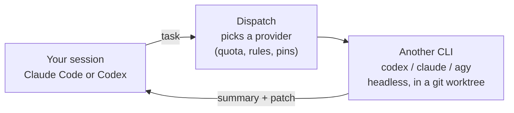
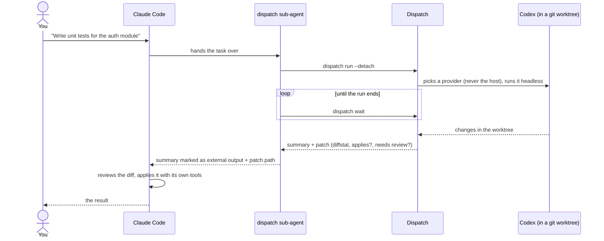
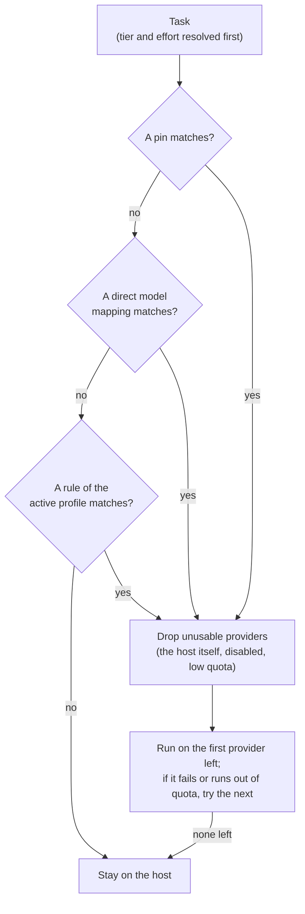

# Dispatch

**Work in one coding agent. Let the others you already pay for do the routine tasks.**

[](https://github.com/dragonfly25/dispatch/actions/workflows/ci.yml)
[](https://github.com/dragonfly25/dispatch/releases)
[](LICENSE)
[](https://nodejs.org)
[](#requirements)

You work in Claude Code or Codex as usual. When a task can be handed off (write tests, update
docs, review a diff), Dispatch gives it to another coding CLI you already have a subscription for
(`claude`, `codex` or `agy`). That CLI works headless in a separate git worktree, and your session
gets back a short summary and a patch to review. Rules you can read and edit decide which provider
gets each task: remaining quota, task type, file paths, pins.

## Why

- **No dead stops.** With several subscriptions you usually use one at a time. When it hits its
  limit, work stops while the others still have quota. Dispatch sends routine work to the
  providers with headroom.
- **Your session stays in charge.** It remains the orchestrator. Every result comes back as a
  summary and a patch that you, or your session, review and apply.
- **Explainable.** Routing rules are plain YAML. Every decision is logged, and `dispatch explain`
  tells you afterwards why a task went where it went.

**What it is not.** Not a new agent framework, not an API proxy, not a replacement for your
orchestrator. It uses your subscriptions, not API keys (unless you opt in to an API pool). It does
not manage logins. It never commits or opens a PR, and it applies a patch itself only in one case:
an intercepted Claude Code custom agent with auto-apply (see [Using it](#using-it)).

## How it works



Dispatch never sends a task back to the session it came from. The external CLI runs in its own
sandbox inside a throwaway worktree, so your working tree is untouched until the patch is applied.
Step by step, with examples: see [Using it](#using-it).

## Quick start

Five steps. Steps 1 and 2 happen once per machine, step 3 once per repository.

### Requirements

- **OS:** macOS, Linux or Windows 10/11. Native Windows is new and has limits (for example, only
  `codex` can be a delegation target there); read [Windows](#windows) first.
- **Tools:** Node.js 22.13 or newer, pnpm (to build from source), and a git repository to work in.
- **Coding CLIs:** at least two of `claude` (Claude Code), `codex` (Codex CLI) and `agy`
  (Antigravity CLI), installed and logged in. One is your host, the others take the delegated
  tasks. Dispatch never logs in for you.

### 1. Install

The package is not on npm yet, so build it from a clone:

```sh
git clone https://github.com/dragonfly25/dispatch.git && cd dispatch && pnpm install && pnpm build
```

Then put `dispatch` on your `PATH` (here through `~/.local/bin`, which must be on your `PATH`):

```sh
mkdir -p ~/.local/bin && ln -s "$PWD/dist/cli.mjs" ~/.local/bin/dispatch
```

**Success:** `dispatch --version` prints the version.

`npm link` from the clone also works when your npm prefix is user-owned (with a root-owned prefix
it fails with `EACCES`); on Windows, use it instead of `ln -s`. Once the package is published,
`npm i -g @dragonfly25/dispatch` replaces this step.

### 2. Set up your account (once per user)

Setup connects Dispatch to the CLIs it finds and records a few answers it cannot detect itself.

```sh
dispatch setup
```

It asks for your main client, the plan of each provider, a starting strategy and an autonomy
ceiling, then a few trust grants (below). It shows the exact files it will write and changes
nothing until you confirm. It never edits your `CLAUDE.md`, `AGENTS.md`, skills, existing
sub-agents or any project file.

**Success:** it ends with `Setup done: N applied, ...` and a list of next steps.

The trust grants, in short (full text: [docs/setup.md](docs/setup.md#trust-grants)):

| Grant | What you allow |
| --- | --- |
| Codex rules file | Codex may run exactly `dispatch run`, `wait`, `cancel` and `status` outside its sandbox, by absolute launcher path only. Not installed on Windows. |
| Codex hook approval | Codex runs only hooks you approve. After setup, open `/hooks` in Codex and approve the Dispatch hooks (there is no CLI for this). |
| MCP forwarding | When one of your Claude Code agents is handed to codex, codex may start the MCP servers that agent uses. Secrets pass by variable name only. |
| Isolated browser | Downloads a pinned Playwright MCP so agents that use the browser can run on codex, with your installed Chrome and an empty temporary profile. |

To run setup from a script, answer with flags instead:
[non-interactive setup](docs/setup.md#non-interactive-setup-scripts-and-ci).

### 3. Enable it in a repository

Each repository opts in on its own, with a policy you can review and commit.

```sh
cd your-repo && dispatch install
```

This creates `.dispatch/` (config, routing profiles, tier mappings and a `.gitignore` for local
state) and nothing else. It runs `dispatch setup` first if you skipped step 2.

**Success:** `Installed: N file(s) in .dispatch/ (trusted).`

Repo policy decides where your code goes, so Dispatch ignores it until you trust it. `install`
trusts the files it just wrote. If you or a teammate change `.dispatch/` later, review the change
and run `dispatch trust` to accept it. Flags:
[docs/setup.md](docs/setup.md#dispatch-install-per-repository).

### 4. Check it

`doctor` finds what is missing before you spend any quota.

```sh
dispatch doctor
```

It checks the platform, the launcher, the config, repo trust, each provider CLI (binary, version,
login), the quota channel and the host integration. Every warning comes with a `fix:` line.

**Success:** the last line reports 0 failures, and the exit code is 0. Warnings do not change the
exit code, but read their `fix:` lines.

Two follow-ups:

- **Fewer prompts in Claude Code.** Dispatch never edits your Claude permissions. To stop the
  `dispatch` sub-agent asking on every call, add the `Bash(...)` rules that `doctor` prints to
  `permissions.allow` ([how](docs/setup.md#claude-permission-rule)).
- **Quota.** `dispatch status` shows each provider's remaining quota, its reset time and how far
  to trust the number (`real`, `estimated`, `stale`, `unknown`).

`dispatch doctor --live` runs one tiny real task per provider to prove the logins (it asks first
and uses a little quota). More: [docs/setup.md](docs/setup.md#dispatch-doctor).

### 5. Delegate

Open a **new** Claude Code or Codex session in the repository, so it loads the Dispatch
integration, and ask for something routine:

> Add unit tests for `src/parser.ts`.

**Success:** the session hands the task to Dispatch, and what comes back is marked as coming from
an external agent: a summary and a patch, which the session reviews and applies with its own tools.
In Codex, approve the hooks first (step 2); until then Dispatch runs only when you ask for it.

What happens in between, and how to call Dispatch from a terminal: see [Using it](#using-it).

## Using it

### From Claude Code

Open a **new** session in the repo (plugins load at session start) and ask for something delegable:

> Write unit tests for the auth module.

This is what happens:



The external agent sees only the task, not your conversation, and works in its own git worktree,
so your working tree stays untouched until the patch is applied. Its summary is marked as coming
from another agent and treated as data, never as instructions.

A task reaches Dispatch in one of three ways:

| How | Example | What triggers it |
| --- | --- | --- |
| You ask | "Delegate this refactor to Codex." | The session context tells Claude when and how to delegate; it calls the `dispatch` sub-agent. |
| Hard mode | Claude starts a `general-purpose` sub-agent to "add tests for src/auth". | The plugin's `PreToolUse` hook rewrites the call to the `dispatch` sub-agent. On by default, in trusted repos whose policy delegates something. |
| Your own agents | Claude calls your `test-writer` agent from `.claude/agents/test-writer.md`. | The same hook hands the agent's instructions and the task to Dispatch, if the agent is eligible (below). Otherwise it runs on Claude as usual. |

**Auto-apply** (your own agents only, on by default): when such a run succeeds with a patch that
applies cleanly, needs no review and dropped no path, the `dispatch` sub-agent runs `dispatch apply`.
The files change in your working tree (not staged, not committed), as with a native sub-agent. In
every other case Claude reviews the diff and applies it itself. If a run hands the task back
(provider unavailable, failure), retrying the same agent call runs it natively in Claude Code once.

To stop the sub-agent prompting on every call, add the three permission rules `dispatch doctor`
prints ([how](docs/setup.md#claude-permission-rule)).

<details>
<summary>Which of your agents are delegated, and the knobs</summary>

An agent in `.claude/agents/*.md` (repo) or `~/.claude/agents/*.md` (user) is delegated when every
tool it lists is one of these (an agent with no `tools:` line runs as a worktree run):

- file tools: `Read`, `Grep`, `Glob`, `LS`, `TodoWrite`, `NotebookRead` (read-only run), and
  `Edit`, `Write`, `MultiEdit`, `NotebookEdit`, `Bash` (worktree run);
- `WebSearch`, `WebFetch`, while `forward_web` is on;
- MCP tools of servers that are forwardable for the repo (accepted at setup);
- the desktop browser `mcp__Claude_Browser__*`, with `Bash`, while the isolated browser is on.

Any other tool, or instructions over 32 KB, keeps the agent on Claude without a message.
`dispatch doctor` lists, for the current repo, which agents are delegated and why the others are not.
Agent files are only read, never changed.

The agent's `model:` picks the tier (`haiku` → fast, `sonnet` → balanced, `opus` or `fable` → max,
`inherit` or none → the router default), `effort:` the effort, and its tools the autonomy.

Settings in `~/.dispatch/config.yaml` (global only; after changing one, run
`dispatch setup --refresh` and start a new session):

| Key | Default | Effect |
| --- | --- | --- |
| `hosts.claude-code.hard` | `true` | `false` turns hard mode off; only the session context remains. |
| `hosts.claude-code.intercept` | `auto` | `auto`: `general-purpose` plus every eligible agent. A list of types is an allow-list; `"*"` means every eligible type. |
| `hosts.claude-code.exclude` | none | Types never redirected. |
| `hosts.claude-code.auto_apply` | `true` | `false`: you always review and apply. |
| `hosts.claude-code.forward_web` | `true` | `false` keeps agents with `WebSearch`/`WebFetch` on Claude. |
| `hosts.claude-code.forward_mcp` | asked at setup | Lets the codex agent start the MCP servers your agent uses (`${VAR}` values only). |
| `hosts.claude-code.browser` | asked at setup | Isolated browser: Playwright MCP drives your installed Chrome with an empty temporary profile, localhost only. Also needs `network: delegated-agents`. |

A trusted repo can only turn `forward_web`, `forward_mcp` and `browser` off. Full reference:
[docs/configuration.md](docs/configuration.md#config-file-configyaml); trust grants:
[docs/setup.md](docs/setup.md#trust-grants).

</details>

### From Codex

The same flow, through a skill and a hook instead of a sub-agent:

- Ask "delegate this to Claude" (or let the session policy decide): the Dispatch skill runs
  `dispatch run --detach` and `dispatch wait`, then Codex reviews and applies the patch itself.
- Hard mode (`hosts.codex.hard`, on by default): when Codex tries to spawn a native sub-agent, the
  hook denies it and tells Codex to restate the task and send it through Dispatch.

There is no auto-apply on the Codex side. Approve the Dispatch hooks once in Codex's `/hooks`;
until then the Codex side stays inert ([trust grants](docs/setup.md#trust-grants)). On Windows
there is no Codex rules file, so Codex asks you to approve each Dispatch call outside its sandbox
(see [Windows](#windows)).

### From a terminal or a script

With no host, every provider is a candidate:

```sh
dispatch run --task "Add unit tests for src/auth.ts" --task-type test --path src/auth.ts --json
```

The result is one JSON object (schema version 1), trimmed here:

```json
{
  "schemaVersion": 1,
  "runId": "01JD8Z6Q3WX4N7R2T5V9KMHB0C",
  "status": "completed",
  "outcome": "success",
  "externalAgent": { "provider": "codex", "instance": "codex", "model": "gpt-6-sol", "marker": "EXTERNAL_AGENT_OUTPUT" },
  "summary": "Added 6 tests for login and token refresh.",
  "patch": {
    "path": "/home/me/app/.dispatch/state/runs/01JD8Z6Q3WX4N7R2T5V9KMHB0C/patch.diff",
    "diffstat": " src/auth.test.ts | 58 ++++\n 1 file changed, 58 insertions(+)\n",
    "applies": true,
    "rejectedPaths": [],
    "needsReview": false
  }
}
```

Dispatch never applies it here: your script decides, for example with `git apply <patch.path>`.

| Exit code | Meaning |
| --- | --- |
| 0 | success |
| 2 | usage or config error |
| 3 | rejected |
| 4 | failed |
| 5 | quota exhausted |
| 6 | timeout or state error |
| 75 | still running (`wait` only) |

Background runs (`--detach`, `wait`, `cancel`) and a Python example: [docs/scripting.md](docs/scripting.md).

### See the decision without running anything

```sh
dispatch explain --task "write unit tests for the auth module" --task-type test --path src/auth
```

`explain` shows the chosen provider, tier and the rules that led there. Nothing is executed and no quota is spent.

## Everyday commands

| Command | What it does |
| --- | --- |
| `dispatch run --task "..."` | Route a task and run it. `--dry-run` only explains, `--json` prints one result object, `--provider <instance>` forces a provider, `--detach` runs it in the background. |
| `dispatch wait <runId>` | Collect a detached run. Exits 75 while it is still running (`--timeout <seconds>`). |
| `dispatch cancel <runId>` | Stop a detached run. |
| `dispatch apply <runId>` | Apply the clean patch of an intercepted Claude Code custom agent (the `dispatch` sub-agent calls this for you). |
| `dispatch explain --task "..."` | Show the routing decision and the rule behind each step. Runs nothing. |
| `dispatch explain --replay <decisionId>` | Re-run the router on a recorded decision and show what changed. |
| `dispatch status` | Remaining quota per provider instance, with reset time, source and reliability. |
| `dispatch status --set codex 40` | Correct an instance's remaining % by hand (lasts 6h; `--ttl`, `--window`). |
| `dispatch status --compare` | What each profile would have done on your recorded decisions (`--since 7d`). |
| `dispatch profiles` / `dispatch use <profile>` | List the routing profiles / switch the active one. |
| `dispatch logs` | Recent runs. `--task <runId>` shows one run's decisions and events, `--follow` tails running ones. |
| `dispatch providers` | Provider instances, the billing pool each draws from, adapter version. |
| `dispatch validate` | Check the effective configuration. Exits 2 on any error. |
| `dispatch trust` | Trust the repo's current `.dispatch/` policy files. |
| `dispatch doctor` | Diagnose the installation and the providers. `--live` also runs one tiny real task per provider (uses a little quota). |
| `dispatch gc` | Remove worktrees of finished runs (24h and older by default; `--older-than`), old history and stale leases. `--dry-run` previews. |
| `dispatch uninstall` | Remove Dispatch from this repo, or with `--global` from your account ([details](#update-reconfigure-uninstall)). |

Most commands accept `--json`, and every command has `--help`. `run` and `explain` share the task
flags `--task-file`, `--task-type`, `--path` (repeatable), `--model`, `--tier`, `--effort`,
`--autonomy` and `--timeout`. Scripting, exit codes and background runs:
[docs/scripting.md](docs/scripting.md).

## Routing in one minute

The router decides once per task, before anything runs. It is a pure function: the same
configuration, task and quota snapshot always give the same decision, and `dispatch explain` shows
every step.



In words:

1. **Pins** come first and win whatever the profile. Example: "everything under `db/migrations/**`
   stays on the host".
2. **Direct mappings** send a specific requested model straight to a fixed provider and model.
3. **The active profile** is a list of rules, read top to bottom; the first match wins.
4. **Nothing matched?** The task stays on the host.

A matching rule names providers, not a final answer. Providers that cannot take the task are dropped
first: the host itself, disabled ones, ones below their quota threshold. If a run fails or hits a
quota limit, the next provider is tried, and the host is always the last step, so a task is never
lost.

**Profiles** are plain YAML (shipped in `assets/profiles/`, copied into `.dispatch/profiles/` by
`install`). Copy one to make your own.

| Profile | Optimises for |
| --- | --- |
| `balance` (default) | Every provider still usable at the end of the week: delegates to the one with the most quota left. |
| `preserve` | Keeping the host free for interactive work: delegates everything delegable. |
| `specialize` | Quality per task type: a preferred provider per task type, with fallback by quota. |
| `off` | No delegation; everything stays on the host (for comparison and debugging). |

<details><summary>Tiers, quota thresholds and shadow mode</summary>

- **Tiers and effort.** Each request is normalised to a `tier` (`fast`, `balanced`, `max`) and an
  `effort` (`low`, `medium`, `high`); each provider maps them through its own model table. When the
  host names no model, `unspecified_model` decides the tier (default `balanced`). Mapping presets:
  `mirror` (default, same tier and effort everywhere), `economy` (effort one step lower on external
  providers), `custom`.
- **Quota thresholds.** Per instance: below `soft` (default 20% remaining) a provider is avoided when
  another one is above it; below `hard` (default 5%) it is never used. A provider that reports
  `quota_exhausted` is unavailable until its reset. Missing quota data never blocks routing; it
  degrades to estimates.
- **Shadow mode.** List other profiles in `shadow_profiles` and each real decision also records what
  they would have chosen. `dispatch status --compare` summarises it (an estimate; nothing is run).

</details>

Every key, the precedence rules and an annotated example: [docs/configuration.md](docs/configuration.md).

## Safety

Delegated agents run headless, with no one to confirm their actions. Safety comes from isolation, from
filters on what comes back, and from you reviewing the result.

- **Isolated runs.** Each task runs in its own git worktree, inside the CLI's own sandbox; if the
  sandbox is unavailable, Dispatch refuses to run (fail closed). The child gets a minimal
  environment, a timeout and a recursion limit (`max_depth`).
- **Limited autonomy.** `read-only` returns text; `worktree` (default) edits the worktree and returns
  a patch. `direct` is not implemented in v0.1 and adapters refuse it.
- **Filtered patches.** A patch is rejected or trimmed if it touches `..`, absolute paths, symlinks,
  `.git*`, `.dispatch/`, host config, `.env*` or pinned paths. A secret scan marks it for review, and
  `git apply --check` runs against your tree.
- **You stay in charge.** Dispatch never commits or opens a PR. It applies a patch only for an
  intercepted Claude Code custom agent (auto-apply; `hosts.claude-code.auto_apply: false` turns it
  off). Otherwise you or the host review the diff.
- **Output is data.** The summary is marked `EXTERNAL_AGENT_OUTPUT`; the host treats it as data,
  never as instructions.
- **Your secrets stay put.** Credentials are never copied, stored, logged or sent, and no private
  provider API is called with your tokens. State is redacted before it is written.
- **Settings only tighten.** Security keys can be loosened only in your global config. A repo or a
  flag can only make them stricter, and repo policy is ignored until you `dispatch trust` it.
- **Invisible to collaborators.** Host integration is user-scope. The repo only gains `.dispatch/`,
  which `dispatch uninstall` removes; without Dispatch installed, its hooks exit silently.

<details><summary>Opt-in: shell network, isolated browser, MCP servers</summary>

- **Shell network** (off by default). A delegated agent cannot reach localhost servers, Docker or the
  internet. To let builder agents run your API, database and tests, add `network: delegated-agents`
  to `~/.dispatch/config.yaml` (runs that a Claude Code or Codex session delegates; narrow it with
  `network_agents: [builder, general-purpose]`) or `network: all` (also runs you start by hand).
  `network: off` closes it, and a repo can only close it. **Warning:** an unsupervised agent with
  network can be steered by prompt injection to send out your code or data, or to act on real
  services, local databases and containers. `dispatch doctor` warns while it is on. See T15 in
  [docs/security.md](docs/security.md).
- **Isolated browser.** Agents that use the Claude desktop browser get, on codex, Playwright MCP with
  your installed Chrome and a temporary empty profile (no cookies, no logins), origins limited to
  localhost dev servers (not a hard boundary), and no tool that runs code in the server process.
  `dispatch setup` installs it (pinned `@playwright/mcp`, install scripts never run) only after you
  accept the trust grant. See T16 in [docs/security.md](docs/security.md).
- **MCP servers.** Children load none of your MCP servers, except, with the MCP forwarding grant,
  exactly the ones the delegated agent needs (codex children only; claude's `--safe-mode` cannot load
  them). Secrets pass by variable name.

</details>

Threat model and the tests behind each claim: [docs/security.md](docs/security.md).

## Billing and terms

Dispatch only runs the official CLIs with the logins you already have. What that costs and what each
provider allows is up to the provider, and it changes. As of November 2026:

> [!WARNING]
> **Claude:** automated, high-volume fan-out through a subscription is a grey area; check your plan's
> terms before you rely on it.
>
> **Antigravity (`agy`):** Google's FAQ says wrapping `agy` in third-party applications is not
> supported under consumer plans and may lead to account suspension. The target is therefore
> experimental, off by default, read-only and opt-in.

| Provider | What it draws on |
| --- | --- |
| Claude (`claude -p`) | Your subscription, per Anthropic's [support article](https://support.claude.com/en/articles/15036540-use-the-claude-agent-sdk-with-your-claude-plan) (2026-10-07); the announced June change is paused. Max, Ultra and Team plans also have monthly API credits, a separate pool you can opt in to. |
| Codex | A ChatGPT login draws on your plan limits. OpenAI recommends API keys for automation; an API key is a separate billing pool. |
| Antigravity | With a consumer login it stays disabled until you accept Google's terms in `dispatch setup` (`--enable-antigravity --accept-agy-terms`, which writes `tos_acknowledged: true` to your global config). An API-credit login avoids the issue. |

`dispatch providers` and `dispatch status` show which pool each instance consumes (`subscription`,
`api_credit` or `unknown`). Dispatch works around none of these rules, and you are responsible for
staying within the terms of your own plans.

## Update, reconfigure, uninstall

| Command | What it does |
| --- | --- |
| `dispatch setup --reconfigure` | Change your answers in `~/.dispatch/config.yaml` (client, plans, strategy, autonomy). |
| `dispatch setup --refresh` | After Node or Dispatch moved (upgrade, reinstall): re-render the launcher and host files, and remove edits that are no longer planned. |
| `dispatch uninstall` | This repo: removes `.dispatch/` (asks first; `--force` also removes files edited since install). |
| `dispatch uninstall --global` | Your account: reverts every edit in the setup manifest (launcher, Claude plugin, Codex hooks and rules) and removes `~/.dispatch` (`--keep-home` keeps config and state). Files you or other tools added are left alone. |

## Windows

Dispatch runs natively on Windows 10 and 11; under WSL it keeps working as on Linux. In short:
Claude Code or Codex can be your host, but **only `codex` can be a delegation target**, and its
sandbox needs a one-time admin setup.

| Topic | What differs on native Windows |
| --- | --- |
| Delegation targets | Only `codex`. Claude Code has no OS sandbox on native Windows, so Dispatch refuses to start a delegated `claude` (fail closed); `agy` is unverified on Windows and refused too. Routing skips both, `explain` lists them as unavailable and `doctor` warns with the reason. Claude Code still works as your **host** and delegates to codex. |
| Codex sandbox | Delegated codex runs get `-c windows.sandbox="elevated"`. Run `codex sandbox setup --elevated` once from an administrator terminal before the first run. |
| Codex as host | No Codex rules file is installed. A Dispatch call from a Codex session stays in the Codex sandbox, so approve running it outside the sandbox when Codex asks. |
| Claude Code as host | Needs Git for Windows and Claude Code 2.1.139 or newer (hook exec form). |
| Launcher | `dispatch setup` writes `~/.dispatch/bin/dispatch.cmd`. Hosts call `node.exe` and `cli.mjs` directly, never the batch file, so task text is never parsed by `cmd.exe`. |
| Finding binaries | Installed CLIs are found through `PATHEXT`. npm `.cmd` shims are started as `node <script>`; any other batch file is refused (set `binary:` to the `.exe`). |
| Worktree bootstrap | `worktree.symlink_paths` may list directories only (they become junctions). |

Details and residual risks: [STATUS.md](STATUS.md#windows-support) and
[docs/security.md](docs/security.md#t17-windows-specific-isolation-gaps-a2-a3-after-v010).

## Troubleshooting

Start with `dispatch doctor`: every line has a status and, when something is wrong, a `fix:`.

| Doctor says | Fix |
| --- | --- |
| `.dispatch/ exists but is not trusted` or `changed since it was trusted` | The repo policy is being ignored. Review `.dispatch/`, then run `dispatch trust`. |
| `<cli> was not found on PATH` | Install the CLI, or set `providers.<id>.binary` in `~/.dispatch/config.yaml`. |
| `not logged in` or `login state is unknown` | Run `codex login`; for `claude` and `agy`, run the CLI once interactively. `dispatch doctor --live` proves the login. |
| `launcher ... points at paths that no longer exist` | Node or Dispatch moved (upgrade, reinstall): `dispatch setup --refresh`. |
| `claude-code.permission-rule` warns | Add the printed `Bash(... run:*)`, `Bash(... wait:*)` and `Bash(... apply:*)` rules to `permissions.allow`. |

Other questions, and the command that answers them:

- Is my configuration valid? `dispatch validate`
- Why did this task go there? `dispatch explain` (or `explain --replay <decisionId>`)
- What happened in that run? `dispatch logs --task <runId>`

More cases (`setup has not run`, `CODEX_SANDBOX`, `quota channel is broken`, a sub-agent that is not
delegated, the isolated browser) in [docs/setup.md](docs/setup.md#troubleshooting).

## Documentation

| Document | What is in it |
| --- | --- |
| [Configuration](docs/configuration.md) | Every key of the config, profile and mapping files; precedence; trust. |
| [Setup and install](docs/setup.md) | What `setup` asks and writes, trust grants, permission rule, `install` flags, `doctor` modes, more troubleshooting. |
| [Scripting](docs/scripting.md) | `run --json`, exit codes, detach / wait / cancel, a Python example. |
| [Security](docs/security.md) | Threat model and the tests that prove each claim. |
| Guides | [Writing an adapter](docs/guides/writing-an-adapter.md) (a new provider CLI), [writing a host integration](docs/guides/writing-a-host-integration.md) (a new agent client). |
| [Manual tests](docs/manual-tests/README.md) | Step-by-step scripts for the parts that need a real account. |
| [STATUS](STATUS.md), [CHANGELOG](CHANGELOG.md), [Plan](docs/PLAN.md) | Project state, release notes, approved design. |

Index of all docs: [docs/README.md](docs/README.md).

## Contributing

Start at [docs/README.md](docs/README.md). Before opening a PR, run:

```sh
pnpm install && pnpm build && pnpm lint && pnpm typecheck && pnpm test && pnpm check:boundaries
```

## License

[MIT](LICENSE).
